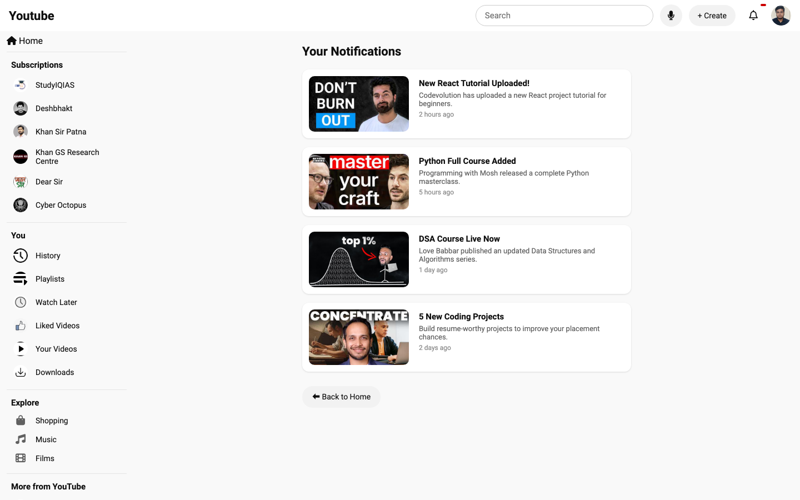

# 🎬 YouTube Webpage Clone

My **first HTML & CSS project** — a YouTube homepage clone built from scratch with plain HTML, CSS and a little vanilla JavaScript. No frameworks, no libraries — just the basics, the way I learned them. 🚀


---

## 📸 Screenshots

### 🏠 Homepage


### 🔔 Notifications Page


---

## ✨ Features

| Feature | Description |
|---------|-------------|
| 🧭 **Top bar** | YouTube-style header with logo, rounded search bar, mic button, **+ Create** button and profile picture |
| 🔍 **Search bar** | Pill-shaped input with a blue glow when you click inside it |
| 📋 **Sidebar** | Subscriptions, You (History, Playlists, Watch Later...) and Explore sections with real channel logos |
| 🎥 **Video grid** | Responsive CSS Grid that wraps videos automatically, 16:9 thumbnails, channel avatars, view counts |
| 🖱️ **Hover effects** | Videos grow slightly with a soft shadow, sidebar items highlight, cards lift up |
| 🔔 **Notification bell (⭐ unique feature)** | Red badge shows unread count (`2+`). Clicking the bell **clears the badge, saves it in `localStorage`** so it stays cleared, and opens the Notifications page |
| 📱 **Responsive** | On small screens the sidebar hides and videos stack in one column |

### ⭐ The notification feature (my favorite part!)

`youtube.js` listens for a click on the bell button:

1. The red **2+ badge** is removed
2. The count is saved with **`localStorage.setItem()`** — so the browser remembers you read them
3. You are taken to **`notification.html`** with all your notifications

---

## 🛠️ Built With

- **HTML5** — semantic structure, two pages (`index.html`, `notification.html`)
- **CSS3** — Flexbox (sidebar layout), CSS Grid (video cards), transitions, media queries
- **JavaScript (vanilla)** — notification click handling + `localStorage`
- **Font Awesome** — icons (bell, mic, sidebar icons)
- **Roboto** — the same font YouTube uses

---

## 🚀 How to Run

No build tools needed — it's plain HTML!

1. Download or clone this repository
2. Double-click **`index.html`** (or open it in your browser)
3. That's it! Click the 🔔 bell to see the notification feature

> Tip: use **Live Server** in VS Code for auto-reload while editing.

---

## 📁 Project Structure

```
Youtube-Webpage/
├── index.html            # Homepage (video grid)
├── notification.html     # Notifications page
├── youtube.css           # Main styles
├── notification.css      # Notification page styles
├── youtube.js            # Bell button logic (badge + localStorage)
├── profile.jpeg          # Profile picture
├── rightlogo/            # Channel logos & sidebar icons
├── screenshots/          # README screenshots
└── demo/                 # Demo GIF + MP4
```

---

## 📖 What I Learned

- How **Flexbox** and **CSS Grid** work together in one layout
- Why `object-fit: cover` matters for thumbnails
- Making round buttons and pill-shaped search bars with `border-radius`
- The **`localStorage`** API — saving data that survives a page refresh
- Small touches (hover states, transitions, focus rings) make a page feel real

---

## 🙌 Credits

Made while learning HTML & CSS. Video thumbnails and channel logos belong to their respective YouTube creators — used here just for practice. 🙏
